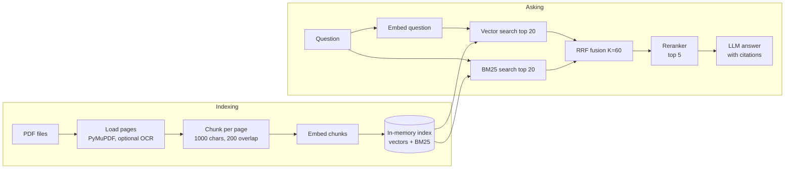

# 📄 Docora

Docora lets you upload PDFs and ask questions about them. Each answer is written only from your documents and cites its sources as `[Source: file.pdf, Page 4]`. If the documents don't contain the answer, it says so instead of guessing. It is a small, session-only RAG (retrieval-augmented generation) app built as a student project.

## How it works



## Features

- Up to 20 PDFs per session, with page-accurate citations
- Hybrid search (meaning + keywords) fused with Reciprocal Rank Fusion, then reranked
- Answer formats: Auto, bullet points, table, email, short summary, step-by-step
- Optional OCR for scanned PDFs (off by default)
- A "Retrieved chunks and scores" table to see why an answer was given
- Providers (LLM, embeddings, reranker, OCR) chosen with environment variables; no code changes to switch

## Quick start (macOS / Linux)

```bash
python3 -m venv .venv
source .venv/bin/activate
pip install -r requirements.txt
cp .env.example .env      # then open .env and paste your API key(s)
python app.py
```

Open the local URL it prints (usually http://127.0.0.1:7860). If a key is missing, the page shows a "Setup needed" box telling you which one.

## Providers

Set these in `.env`. You only need keys for the providers you select.

| Role | Variable | Allowed values | Default | Key needed |
|---|---|---|---|---|
| LLM | `LLM_PROVIDER` | `gemini`, `openai` | `gemini` | `GOOGLE_API_KEY` / `OPENAI_API_KEY` |
| Embeddings | `EMBEDDING_PROVIDER` | `gemini`, `openai` | `gemini` | same as above |
| Reranker | `RERANK_PROVIDER` | `cohere`, `jina` | `cohere` | `COHERE_API_KEY` / `JINA_API_KEY` |
| OCR | `OCR_PROVIDER` | `vision_llm`, `tesseract`, `none` | `vision_llm` | uses the LLM key (or none for Tesseract) |

Model names have defaults in `config/settings.py` and can be overridden in `.env` (for example `GEMINI_LLM_MODEL`). If a provider renames a model, change the variable and nothing else.

Important: embeddings are not interchangeable. If you change `EMBEDDING_PROVIDER` or its model, restart the app and re-index your files.

### Adding a provider

1. Create `providers/<name>_provider.py` with a class that implements the interface in `providers/base.py` (import the SDK inside the constructor, wrap retries with `@retry`, raise `ProviderError`).
2. Add one line to the matching table in `providers/registry.py`.
3. Add its key name and model name lines in `config/settings.py`.

### OCR options

- `vision_llm` (default): sends scanned pages to your LLM as images. No extra install, but slower and uses API calls. Only runs when you tick the OCR box.
- `tesseract`: runs locally. Install it with `brew install tesseract` (macOS), then `pip install -r requirements-local-ocr.txt`. If it isn't on your PATH, set `TESSERACT_CMD_PATH` (on Apple Silicon this is typically `/opt/homebrew/bin/tesseract`).
- `none`: turns OCR off and hides the checkbox.

## Design decisions

- **Hybrid search.** Vector search finds paraphrases; BM25 finds exact words such as names and codes. Each misses things the other catches.
- **RRF fusion.** Vector and BM25 scores are on different scales, so we merge by rank (`1/(60+rank)`) instead of trying to normalize scores.
- **Reranker.** A reranker reads the question and each candidate together, which is more accurate than comparing embeddings. It runs on only ~40 candidates, so cost stays low. If it fails, Docora falls back to the RRF order and shows a warning.
- **In-memory index.** At most 20 PDFs, one session: a NumPy matrix and a BM25 list are fast and need no database or extra service.
- **No LangChain or vector database.** The pipeline is small enough to read in one sitting, and fewer dependencies means fewer things to break.
- **Page-bounded chunks.** A chunk never spans two pages, so every citation points to exactly one page.

## Known limitations

- Session-only: closing or restarting the app forgets everything. Single user per running app.
- PDF only.
- A sentence that runs across a page break is cut at the page boundary.
- Every question costs API calls, and your documents' text is sent to the third-party providers you choose. Don't upload anything you aren't allowed to share with them.
- OCR processes pages one at a time, so large scanned files are slow.
- Very small documents (one or two chunks) get no BM25 contribution (a quirk of the BM25 formula); vector search carries the answer.
- Answer quality depends on the LLM; always check the cited page for anything important.

## Tests and evaluation

```bash
pip install -r requirements-dev.txt
python -m pytest tests -q
```

The tests need no API keys or network.

To compare retrieval with and without the reranker on your own documents:

1. Put PDFs in `eval/sample_docs/`.
2. Copy `eval/questions.example.json` to `eval/questions.json` and edit it: each question lists the `filename` and `page` that should contain the answer.
3. Run `python eval/run_eval.py` (needs your `.env`). It prints Hit@1, Hit@5 and MRR and saves `eval/results.md`.

## Deployment (Hugging Face Spaces)

1. Create a new Space, SDK **Gradio**, and push this folder to it. The block at the top of this README is the Space configuration.
2. In Space **Settings → Variables and secrets**, add your keys as **secrets** (`GOOGLE_API_KEY`, `COHERE_API_KEY`, ...) and any provider choices as variables. Never commit `.env`.
3. The free CPU Space sleeps after a period of inactivity and wakes on the next visit; the index is lost whenever it restarts.
4. For local Tesseract on Spaces you would need a `packages.txt` containing `tesseract-ocr`; it isn't included by default because the default OCR uses the LLM.
5. A public Space lets anyone spend your API credits. Set spending limits with your providers, or keep the Space private.

## Project layout

```
app.py          Gradio interface (presentation only)
config/         settings.py (env + constants), prompts.py (all prompt text)
core/           loader, chunker, index, retriever, reranker, generator, pipeline
providers/      one file per provider + base interfaces + registry
utils/          retry, small helpers
tests/          pytest, no network
eval/           retrieval evaluation script
```
